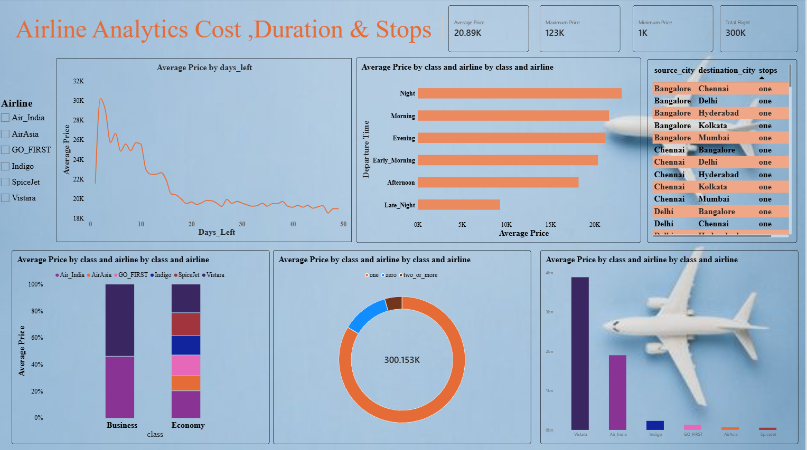

✈️ Airline Flight Price Analysis Dashboard

📌 Project Overview

The Airline Flight Price Analysis Dashboard is a data analytics project developed using Microsoft Power BI to explore airline ticket prices, flight durations, stop categories, and differences between airlines and routes.

The project transforms raw flight data into an interactive dashboard that helps users compare flight prices, investigate travel patterns, and understand how ticket prices vary across different flight categories.

🎯 Project Objectives

- Analyze flight ticket prices across airlines and stop categories.
- Compare average ticket prices across different flight options.
- Explore differences in flight duration and route characteristics.
- Build an interactive dashboard for data exploration and comparison.
- Apply data preparation, visualization, and analytical techniques using Power BI.

🛠️ Tools and Technologies

- Microsoft Power BI: Dashboard development and data visualization.
- Power Query: Data cleaning and transformation, where applied.
- DAX (Data Analysis Expressions): Measures and calculations, where applied.
- CSV Dataset: Source data for the analysis.

📂 Dataset Description

The dataset contains approximately 300,000 flight records and includes information about airlines, ticket prices, travel durations, routes, and stop categories.

Dataset Columns

Column| Description
"airline"| Name of the airline
"arrival_time"| Arrival time category or value
"class"| Travel class
"days_left"| Number of days remaining before departure
"departure_time"| Departure time category or value
"destination_city"| Destination city
"duration"| Flight duration
"flight"| Flight identifier or number
"index"| Record index
"price"| Flight ticket price
"source_city"| Departure city
"stops"| Number or category of stops

📊 Dashboard Preview

The dashboard provides a visual overview of flight pricing and travel characteristics. It includes summary metrics, airline comparisons, price analysis, and route-related visualizations.

📈 Key Numerical Findings

Metric| Result
Total flight records| Approximately 300,000
Overall average ticket price| Approximately 20,890
AirAsia average ticket price| Approximately 4,090*
Average price — non-stop flights| 9,375.94
Average price — one-stop flights| 22,900.99
Average price — two or more stops| 14,113.45

Key Insights

- Non-stop flights recorded the lowest average ticket price among the three stop categories.
- One-stop flights recorded the highest average ticket price.
- Flights with two or more stops had an average price between the other two categories.
- Ticket prices vary across flight categories, and other factors such as airline, route, and travel class may also contribute to these differences.

Confirm that AirAsia's value represents its average ticket price, and specify the currency after verifying the dataset.
<h5>Key Insights:</h5>

- Non-stop flights: Recorded the lowest average ticket price among the three categories, at 9,375.94.
- One-stop flights: Recorded the highest average ticket price, at 22,900.99.
- Two or more stops: Recorded an average ticket price of 14,113.45, lower than the one-stop category but higher than non-stop flights.

Interpretation: The results indicate that ticket prices do not necessarily increase with the number of stops. Other variables, including airline, route, travel class, and departure timing, may also contribute to price differences.

These are observed associations in the dataset and do not establish that the number of stops directly causes a change in ticket price.

5. Average Flight Duration

- Reported dashboard value: 12.22.

Insight: Flight duration can help compare travel options and understand differences between routes.

Note: The unit and calculation of the 12.22 value must be verified before drawing a numerical conclusion. It should not yet be interpreted as decimal hours or hours and minutes.

💡 Overall Project Insights

The analysis highlights several useful observations:

1. Average ticket prices vary across airlines and flight categories.
2. Non-stop flights have a lower observed average price than one-stop and multi-stop flights in the current results.
3. One-stop flights have the highest observed average price among the three stop categories.
4. Comparing airlines and routes provides additional context for understanding price differences.
5. Interactive Power BI visuals make it easier to explore flight data and compare available categories.

These findings describe the observed dataset. Further analysis would be needed to determine how much each factor contributes to ticket prices.

🧮 Example DAX Measures

The following measures illustrate how key metrics can be calculated in Power BI. Replace "flights" with the actual name of your table if it differs.

<b>Total Flight Records</b>

Total Flight Records =
COUNTROWS(flights)

<b>Average Ticket Price</b>

Average Ticket Price =
AVERAGE(flights[price])

Average Ticket Price by Stop Category

Use "stops" as the category in a chart and "Average Ticket Price" as the value. Power BI will calculate the average for each stop category in the current filter context.

🚀 Skills Demonstrated

- Data analysis and exploration
- Data cleaning and transformation
- DAX measures and aggregations
- Interactive dashboard development
- Data visualization
- Comparative analysis and insight communication

Only retain the skills and techniques that you actually used in the project.

🔮 Future Improvements

- Verify and standardize flight duration into numeric minutes.
- Compare average ticket prices across travel classes and airlines.
- Analyze the relationship between advance booking days and ticket prices.
- Investigate route-level price differences.
- Add more detailed filters and performance indicators.
- Explore additional factors that may explain variations in ticket prices.

📝 Conclusion

This project demonstrates the use of Microsoft Power BI to analyze airline flight data and present key metrics through an interactive dashboard.

By comparing average ticket prices across airlines and stop categories, the project identifies differences in observed pricing patterns and provides a foundation for further analysis of flight costs and travel characteristics.

The project also demonstrates practical experience in transforming data into visual insights that can support exploration and comparison.

---

Project: Airline Flight Price Analysis Dashboard
Primary Tool: Microsoft Power BI
Dataset Size: Approximately 300,000 flight records
